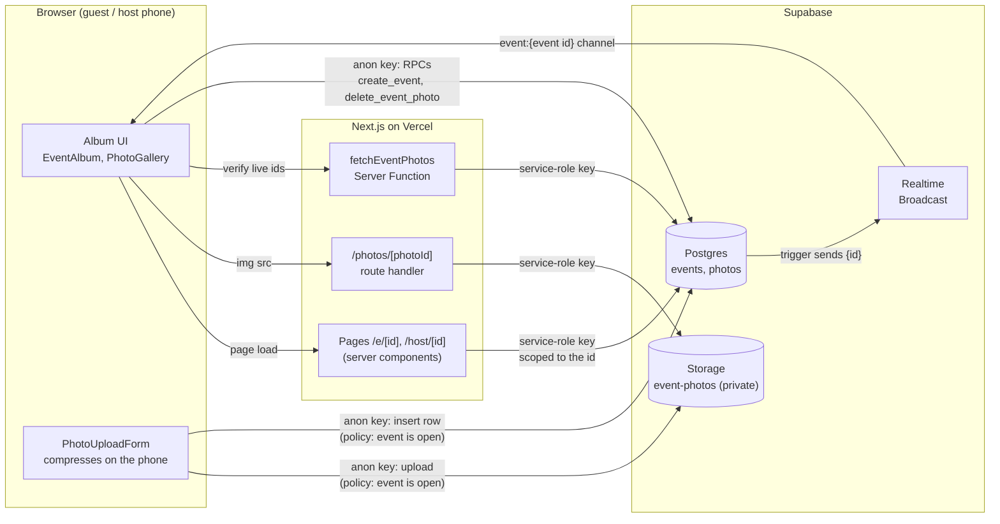
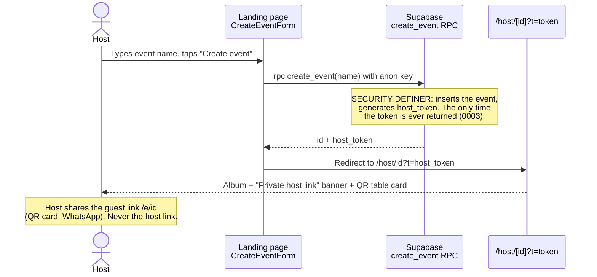
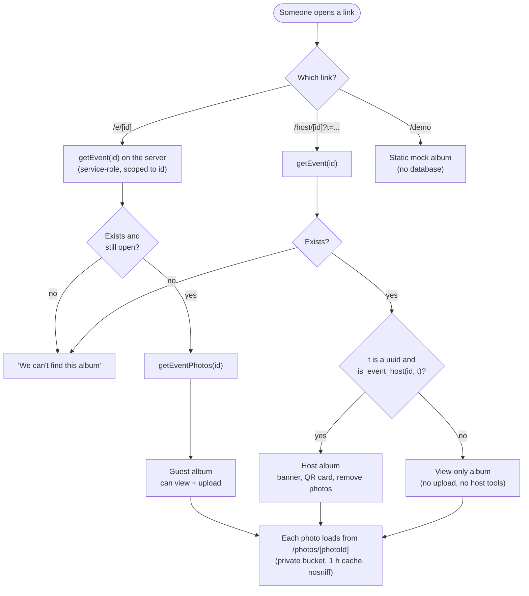
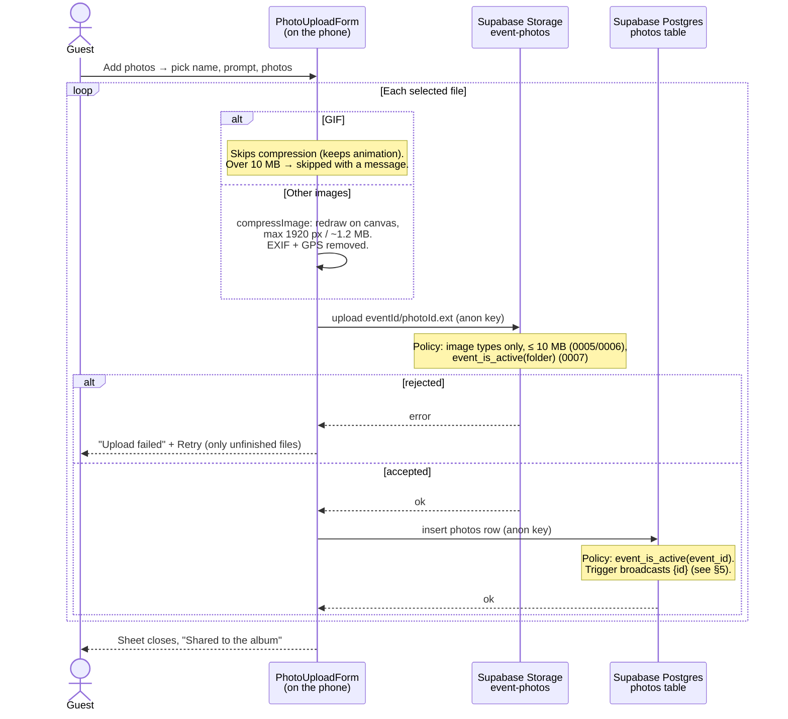
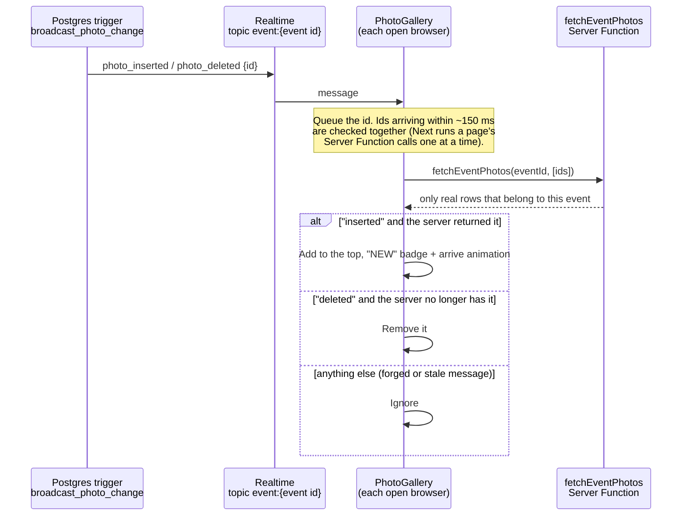
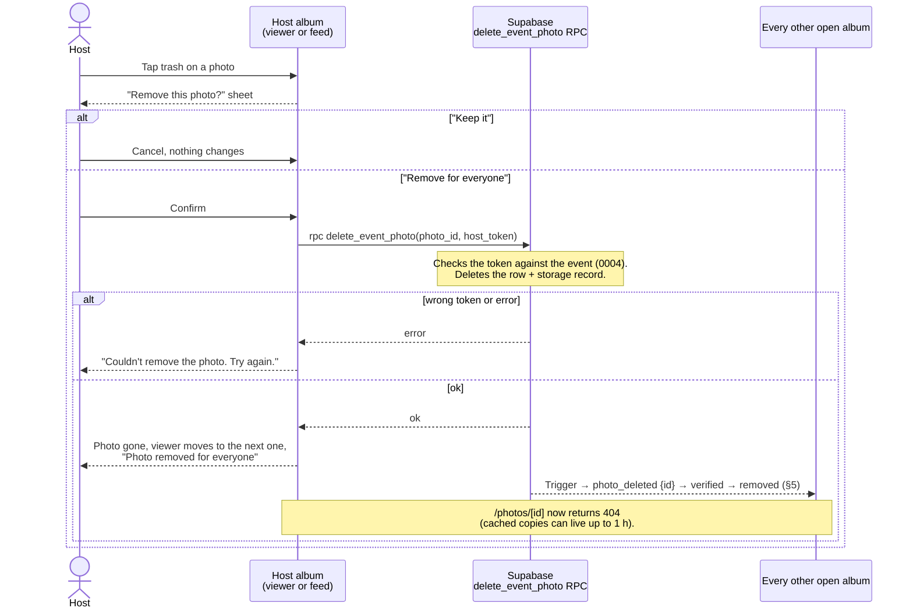
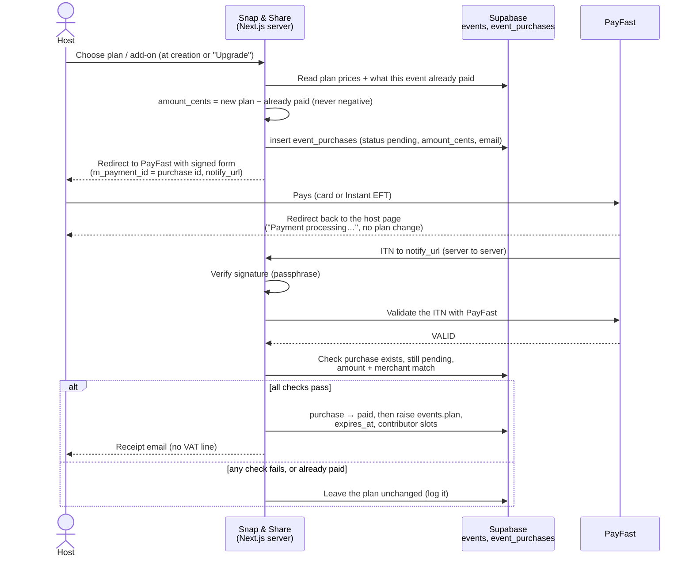
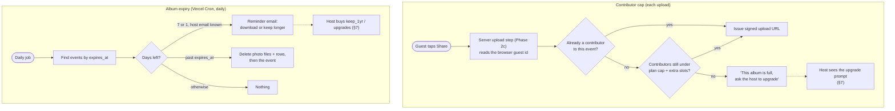

# Snap & Share — Process flows

How the app works end to end, as Mermaid diagrams (rendered on GitHub and in
VS Code's Markdown preview). Sections 1–6 describe the app **as built**;
sections 7–8 are **planned** (see [PRICING.md](PRICING.md) and
[ROADMAP.md](ROADMAP.md)). File and function names match the code.

- [1. Big picture](#1-big-picture)
- [2. Host creates an event](#2-host-creates-an-event)
- [3. Opening an album (guest, host, viewer)](#3-opening-an-album-guest-host-viewer)
- [4. Guest uploads a photo](#4-guest-uploads-a-photo)
- [5. Live updates](#5-live-updates)
- [6. Host removes a photo](#6-host-removes-a-photo)
- [7. Planned: buying or upgrading a plan](#7-planned-buying-or-upgrading-a-plan)
- [8. Planned: contributor cap and album expiry](#8-planned-contributor-cap-and-album-expiry)

---

## 1. Big picture

Who talks to what. Reads go through the Next.js server with a secret key;
writes go straight from the browser to Supabase and are checked by the
database.

---

## 2. Host creates an event

---

## 3. Opening an album (guest, host, viewer)

Knowing the link is what grants access, enforced on the server.

---

## 4. Guest uploads a photo

---

## 5. Live updates

Every open album hears about new and removed photos. Messages carry only
the photo id and are always checked with the server, because anyone can send
on a public channel.

---

## 6. Host removes a photo

---

## 7. Planned: buying or upgrading a plan

Monetisation Stage B ([PRICING.md](PRICING.md)). Every event starts on Free; picking a paid plan at creation and upgrading later are the same flow. The plan only changes after PayFast's verified server-to-server notification (ITN), never from the browser redirect.

---

## 8. Planned: contributor cap and album expiry

Monetisation Stages A–B. The cap is checked in the server upload step that
Phase 2c introduces; expiry runs as a daily job.

